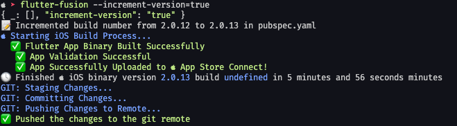
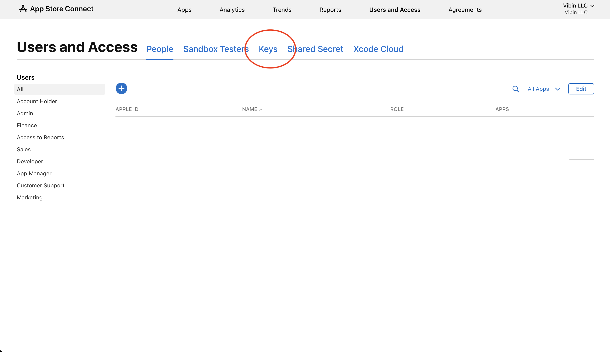
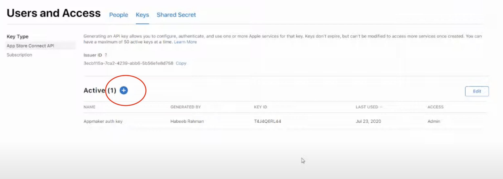
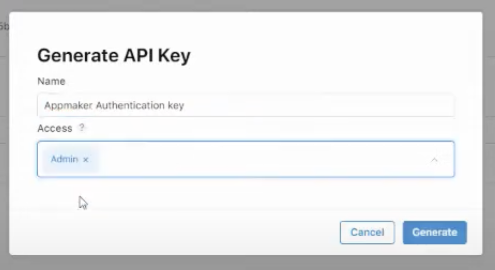
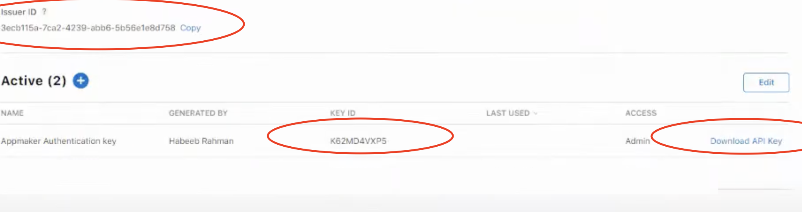

# Flutter Fusion

### The ultimate Flutter build tool


👷 This is still a work in progress. Only building for iOS is support at the moment.

## 💡 Idea

Idk about y'all but I'm tired of manually uploading my builds to App Store Connect and the Play Store. It would be amazing if there is something simple that lets me compile the app on my own computer, manage the versioning, and automatically compile and upload my Flutter app to where ever it needs to be and push to version control. This is where Flutter Fusion comes in!

## Usage

Instead of running flutter build simply run this instead abstracted command in the root of your flutter project

```bash
flutter-fusion
```

Here is an example of how the output will look!
<br />

<br />
This screenshot is a bit outdated, some verbiage has been improved

Optional flags:

- `--git=true|false`: This overrides the default setting in your pubspec to enable or disable committing and pushing to git.
- `--increment-build=true|false`: This overrides the default setting in your pubspec to automatically increment your build number (ex: from 1.0.0+1 --> 1.0.0+2).
- `--increment-version=true`: Increment a whole minor version (ex: from 1.0.0+3 --> 1.0.1+0).
- `--tests=true|false`: This overrides the default setting in your pubspec to enable or disable running `flutter test` before the build.

This command alone will automatically build your iOS (Android & Web coming soon) app a proper versioning increment, validate the archives, upload the archives, then auto commit your changes to source control.

### Logs

Every command Flutter Fusion runs (`flutter build`, `xcrun altool`, `git`, …) is captured — including full stdout/stderr and exit codes — to a `flutter_fusion.log` file in your Flutter project's root directory. This file is recreated fresh on each run, so it always reflects your most recent build. If a build fails, check it there for the full details.

> Tip: add `flutter_fusion.log` to your project's `.gitignore` so it isn't committed.

### Tests

Before building, Flutter Fusion runs your test suite with `flutter test` and streams its live progress output straight to your terminal. If every test passes, the build continues; if any test fails, the run stops with exit code `1` so a broken build never ships.

The behavior is controlled by `run_tests` in your pubspec (or the `--tests` flag):

- **`run_tests` unset (the default):** tests run if your project has any (`test/**/*_test.dart`). If there are none, the step is quietly skipped.
- **`run_tests: true`:** tests are required. If no tests exist, the run exits with an error telling you to add tests or disable this setting.
- **`run_tests: false`:** tests are never run.

If tests fail (or are required but missing), the error message reminds you that you can turn test runs off with `run_tests: false` under `flutter_fusion` in your `pubspec.yaml`.

### Swift Package Manager (SPM) updates

Xcode has no command to _upgrade_ your Swift Package dependencies — it only ever resolves to whatever is already pinned in `Package.resolved`. Flutter Fusion works around this by backing up `Package.resolved`, deleting it, and letting `xcodebuild -resolvePackageDependencies` regenerate it against the version ranges your packages declare (which re-resolves to the newest allowed versions), then diffing the result. The backup lives in `.dart_tool/flutter_fusion/spm/` inside your project, so nothing is ever lost.

```bash
flutter-fusion spm up        # upgrade in place and print each module old → new
flutter-fusion spm outdated  # show available updates, then ask y/n before applying
```

- `spm up` upgrades immediately and prints every module that changed (from → to), plus any added/removed packages. Your previous `Package.resolved` is kept in the cache as a restore point.
- `spm outdated` is non-destructive: it discovers the available updates, prints them, reverts your `Package.resolved` back to its original state, and then prompts you with `y/n`. Only if you answer yes does it switch to the upgraded versions.

Both require macOS and a working Xcode/Flutter setup (they use `xcodebuild`). By default the workspace is auto-detected under `ios/` (then `macos/`); override it with `spm_workspace` / `spm_scheme` in your config if needed.

You can also run either step automatically before every build via your pubspec (see the config below). The default is neither. If you enable both, Flutter Fusion warns you and runs `outdated` (the less destructive option).

## Setup

### Installation

- Install the Deno runtime if you haven't already (Deno 2.x)
  - https://deno.com/manual/getting_started/installation
  - If you are unsure, you can run `deno --version` , if it gives an error when running this command, then you do not have Deno installed
- Install flutter-fusion

```bash
deno install -g -f -n flutter-fusion --allow-read --allow-env --allow-run --allow-write --allow-sys --allow-net https://flutter-fusion.sethusenthil.com/main.ts
```

### iOS and MacOS

Most of this setup will be standard for most build tools and solutions, there is no way around this cumbersome task. However, we are working on a utlity script to make it just a little easier (Still in the works)

- Have Xcode fully installed
- Get your App Store Connect API Key
  - Go to: https://appstoreconnect.apple.com/access/users
    - You will need Admin rights (if it's your account you don't have to worry about this)
  - Navigate to Keys
    - 

  - Create a new key
    - 
    - 
      - Name is whatever you want, does not matter
      - Only the `Developer` permission is required, however you may grant `Admin` as well (as shown in the image)
  - Download the key to your downloads folder
    - 
  - Create a folder in your home directory called `private_keys`
    - `mkdir -p ~/private_keys`
  - Create a new file called pubspec.yaml (sound familiar 😉) in the same `private_keys` folder
    - `touch -p ~/private_keys/pubspec.yaml && code ~/private_keys/pubspec.yaml`
  - This is where your global settings for Flutter Fusion will be written
  - Paste the following into it and replace it with your information

```yaml
flutter_fusion:
  APP_STORE_CONNECT_API_KEY_ID: "YOUR_API_KEY_ID_HERE" #should be similar to your .p8 file name
  API_KEY_ISSUER: "YOUR_API_KEY_ISSUER_FROM_APPSTORE_CONNECT"
```

### General Setup

This is the same for all flutter targets

- In your projects pubspec, simply add the following entry and customize it to your liking. All options can be omitted and it will take its default value, or the value passed in as a flag when running the command.

```yaml
flutter_fusion:
  verbose: false #print all outputs
  #build_flags: ["--no-tree-shake-icons"] #you can pass in additional flags for `flutter build`
  ios: true #enable build and upload for iOS
  android: false #enable build and upload for Android
  web: false #enable build and upload for Web
  auto_increment_build: false #would recommend setting to TRUE. This will automatically increment your build number (can be overridden temporarily using CLI flag)
  git: false #would recommend setting this to TRUE if you use a git repo. This will automatically commit your code with the provided message and push to remote
  #run_tests: true #run `flutter test` before building. Defaults to true when tests exist; set to false to skip. If set to true but no tests exist, the build errors out
  spm_update_on_build: false #run `spm up` (upgrade Swift packages) automatically before each build
  spm_outdated_on_build: false #run `spm outdated` (show + prompt) automatically before each build. If both spm_* options are true, `outdated` wins
  #spm_workspace: "ios/Runner.xcworkspace" #optional: override the auto-detected .xcworkspace
  #spm_scheme: "Runner" #optional: override the scheme passed to xcodebuild (defaults to Runner)
```

- You can also add these values to your global pubspec located in ~/private_keys/pubspec.yaml file created earlier to use these settings across multiple Flutter projects
  - options ios, android, web, git and auto_increment_build cannot be set globally as they generally change between projects and require unique setup

#### More info on Git

Flutter Fusion will create a file called 'COMMIT_EDITMSG' on first run. In this file you can enter your commit description. It is reset after every build is uploaded correctly. The title of your commit will always be your entire build version.

The idea of this Git practice is so you enter the changes into this file while you are doing while you are doing them, so when you build and push a new version, these changes are automatically tagged onto the commit description in a neat manner
